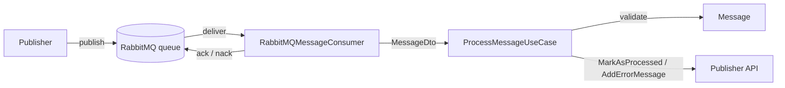

# rabbitmqconsumer-dotnet

A .NET 10 worker service that consumes messages from a RabbitMQ queue, validates each one against the domain rules and notifies the **Publisher API** of the outcome: the message is marked as processed, or the error is reported back.

The service is built to keep running unattended: it reconnects to RabbitMQ automatically, retries transient HTTP failures, and only acknowledges a message once its processing has been confirmed.



## Message flow

Each delivery is deserialized, handed to the use case and then acknowledged according to the result:

| Result | When | Broker action |
|---|---|---|
| `Processed` | The message is valid and the Publisher API accepted `MarkAsProcessed` | `ack` |
| `Rejected` | The body is empty or not valid JSON, or the message breaks a domain rule (`Id` must be greater than zero, `Payload` must not be empty) | `nack` without requeue |
| `Failed` | The message is valid but `MarkAsProcessed` failed after all retries; the error is sent to `AddErrorMessage` | `nack` without requeue |
| — | The service is shutting down while a message is in flight | No ack: the broker redelivers it |

Rejected and failed messages are not requeued, so a poison message cannot block the queue. Configure a dead-letter exchange (`x-dead-letter-exchange`) on the queue to keep them for inspection.

## Architecture

The solution follows **Clean Architecture**: dependencies only point inwards, so the business rules know nothing about RabbitMQ, HTTP or JSON.

```
App ──► Infrastructure ──► Application ──► Domain
 └──────────────────────────► Application
```

| Project | Responsibility | Depends on |
|---|---|---|
| `RabbitMQConsumer.Domain` | Business rules. `Message.TryCreate` decides what a valid message is | Nothing |
| `RabbitMQConsumer.Application` | Use cases and ports. `ProcessMessageUseCase` orchestrates the processing through the `IPublisherApiClient` port | Domain |
| `RabbitMQConsumer.Infrastructure` | Adapters: RabbitMQ consumer and connection, HTTP client for the Publisher API, options and their validation | Application, Domain |
| `RabbitMQConsumer.App` | Composition root: builds the host, configures Serilog and calls `AddApplication()` / `AddInfrastructure()` | Application, Infrastructure |
| `RabbitMQConsumer.Test` | Unit and architecture tests | All of the above |

```
RabbitMQConsumer.Domain/
└── Messages/Message.cs
RabbitMQConsumer.Application/
├── Abstractions/IPublisherApiClient.cs
├── Messages/ (MessageDto, IProcessMessageUseCase, ProcessMessageUseCase, MessageProcessingResult)
└── DependencyInjection.cs
RabbitMQConsumer.Infrastructure/
├── Messaging/RabbitMQ/ (RabbitMQMessageConsumer, RabbitMQConnectionProvider, RabbitMQConnectionFactoryBuilder, RabbitMQOptions)
├── Http/ (JsonHttpClient)
├── Http/PublisherApi/ (PublisherApiClient, UrlOptions, Contracts/)
└── DependencyInjection.cs
RabbitMQConsumer.App/
├── Program.cs
└── appsettings.json
```

The dependency rule is enforced by `RabbitMQConsumer.Test/Architecture/DependencyRuleTests.cs`, which fails if Domain references anything outside the framework or if Application references RabbitMQ, HTTP, JSON, hosting or Infrastructure assemblies.

## Technologies

| Area | Technology |
|---|---|
| Runtime | .NET 10, C#, Worker Service on the Generic Host (`BackgroundService`) |
| Messaging | [RabbitMQ.Client](https://github.com/rabbitmq/rabbitmq-dotnet-client) 7.2.2 (async API, automatic connection and topology recovery) |
| HTTP | `IHttpClientFactory` typed client + [Microsoft.Extensions.Http.Resilience](https://learn.microsoft.com/dotnet/core/resilience/http-resilience) 10.11.0 (Polly v8) |
| Configuration | Options pattern with DataAnnotations validation on startup |
| Logging | Serilog: console and rolling compact-JSON file, configured from `appsettings.json` |
| Serialization | System.Text.Json with source generation, for incoming messages and outgoing requests |
| Testing | xUnit, NSubstitute, `FakeLogger` (Microsoft.Extensions.Diagnostics.Testing), coverlet |

## Patterns and practices

- **Clean Architecture / Ports and Adapters**: Application defines the `IPublisherApiClient` port; Infrastructure provides the adapters. The broker consumer is a driving adapter that calls the use case.
- **Use case with an explicit result**: `ProcessMessageUseCase` returns `Processed`, `Rejected` or `Failed`, and the transport decides how to acknowledge it. Business logic never touches ack/nack.
- **Domain factory**: `Message.TryCreate` is the only way to build a valid `Message`, so invalid messages cannot reach the rest of the flow.
- **Dependency Injection per layer**: each layer registers its own services (`AddApplication()`, `AddInfrastructure()`); the host only composes them. A scope is created per delivery, so scoped services are never captured by the singleton consumer.
- **Resilience on HTTP calls**: standard resilience pipeline with 3 retries (exponential backoff with jitter), 10 s per-attempt and 60 s total timeouts, and a circuit breaker. Retries respect `Retry-After`.
- **Resilient RabbitMQ connection**:
  - a single shared connection, created safely under concurrency;
  - exponential backoff while the broker is unreachable at startup;
  - automatic recovery after network failures;
  - the channel is recreated when the broker closes it with a channel-level error.
- **At-least-once delivery**: manual acknowledgements, bounded prefetch (`PrefetchCount`) and ack only after the Publisher API confirms. Downstream endpoints should be idempotent by `Id`.
- **Fail fast configuration**: options are validated when the host starts; a missing value or an invalid URL stops the service with a clear error.
- **Structured logging**: message templates with named properties (`{MessageId}`, `{DeliveryTag}`, …) instead of string concatenation.

## Configuration

Settings live in `RabbitMQConsumer.App/appsettings.json`:

```json
{
  "RabbitMQOptions": {
    "Name": "rabbitmq-consumer",
    "Host": "localhost",
    "User": "guest",
    "Pwd": "guest",
    "Queue": "messages",
    "Port": 5672,
    "VirtualHost": "/",
    "PrefetchCount": 10,
    "HeartbeatSeconds": 30,
    "NetworkRecoveryIntervalSeconds": 5,
    "MaxConnectRetryDelaySeconds": 60
  },
  "UrlOptions": {
    "PublisherApi": {
      "MarkAsProcessed": "http://localhost:5000/messages/mark-as-processed",
      "AddErrorMessage": "http://localhost:5000/messages/add-error-message"
    }
  }
}
```

| Key | Description |
|---|---|
| `RabbitMQOptions:Name` | Base connection name. Each instance appends its machine name (the container id in Docker), so the RabbitMQ management UI shows one unique name per instance, e.g. `rabbitmq-consumer-3f9c2a1b7d4e` |
| `RabbitMQOptions:Host`, `Port`, `VirtualHost` | Broker address |
| `RabbitMQOptions:User`, `Pwd` | Broker credentials |
| `RabbitMQOptions:Queue` | Queue to consume from |
| `RabbitMQOptions:PrefetchCount` | Maximum unacknowledged messages delivered at once |
| `RabbitMQOptions:HeartbeatSeconds` | Heartbeat interval used to detect dead connections |
| `RabbitMQOptions:NetworkRecoveryIntervalSeconds` | Wait between automatic recovery attempts |
| `RabbitMQOptions:MaxConnectRetryDelaySeconds` | Upper bound of the backoff while the broker is unreachable |
| `UrlOptions:PublisherApi:MarkAsProcessed` | Absolute URL called with `{ "id": … }` when a message is processed |
| `UrlOptions:PublisherApi:AddErrorMessage` | Absolute URL called with `{ "id": …, "text": … }` when processing fails |

All values are required, and the URLs must be absolute `http`/`https` URLs. The committed `appsettings.json` contains placeholders, so the service will not start until real values are provided. Prefer environment variables (or user secrets) for environment-specific values and credentials:

```bash
export RabbitMQOptions__Host=localhost
export RabbitMQOptions__Pwd=guest
export UrlOptions__PublisherApi__MarkAsProcessed=http://localhost:5000/messages/mark-as-processed
```

## Getting started

Requirements: [.NET 10 SDK](https://dotnet.microsoft.com/download) and a RabbitMQ broker.

Start RabbitMQ locally (management UI at http://localhost:15672, user `guest` / `guest`):

```bash
docker run -d --name rabbitmq -p 5672:5672 -p 15672:15672 rabbitmq:4-management
```

Build and run the service:

```bash
dotnet build RabbitMQConsumer.slnx
dotnet run --project RabbitMQConsumer.App
```

Run the tests:

```bash
dotnet test RabbitMQConsumer.slnx
```

## Deployment (Coolify)

The repository includes a `Dockerfile` and a `docker-compose.yml` ready for Coolify's **Docker Compose** build pack.

- **Image**: multi-stage build on the official .NET 10 images. The final image uses the .NET runtime only (no ASP.NET Core) and runs as a non-root user.
- **Configuration**: `docker-compose.yml` maps Coolify environment variables to the configuration keys. Coolify lists them in the resource's *Environment Variables* tab: variables written as `${VAR:?}` are required, and `${VAR:-value}` have a default. They override `appsettings.json`, and the service still validates them on startup.

| Coolify variable | Configuration key | Default |
|---|---|---|
| `RABBITMQ_CLIENT_NAME` | `RabbitMQOptions:Name` | `rabbitmq-consumer` |
| `RABBITMQ_HOST` | `RabbitMQOptions:Host` | required |
| `RABBITMQ_PORT` | `RabbitMQOptions:Port` | `5672` |
| `RABBITMQ_VIRTUAL_HOST` | `RabbitMQOptions:VirtualHost` | `/` |
| `RABBITMQ_USER` | `RabbitMQOptions:User` | required |
| `RABBITMQ_PASSWORD` | `RabbitMQOptions:Pwd` | required |
| `RABBITMQ_QUEUE` | `RabbitMQOptions:Queue` | required |
| `RABBITMQ_PREFETCH_COUNT` | `RabbitMQOptions:PrefetchCount` | `10` |
| `RABBITMQ_HEARTBEAT_SECONDS` | `RabbitMQOptions:HeartbeatSeconds` | `30` |
| `RABBITMQ_NETWORK_RECOVERY_INTERVAL_SECONDS` | `RabbitMQOptions:NetworkRecoveryIntervalSeconds` | `5` |
| `RABBITMQ_MAX_CONNECT_RETRY_DELAY_SECONDS` | `RabbitMQOptions:MaxConnectRetryDelaySeconds` | `60` |
| `PUBLISHER_API_MARK_AS_PROCESSED_URL` | `UrlOptions:PublisherApi:MarkAsProcessed` | required |
| `PUBLISHER_API_ADD_ERROR_MESSAGE_URL` | `UrlOptions:PublisherApi:AddErrorMessage` | required |
| `DOTNET_ENVIRONMENT` | Hosting environment | `Production` |

**Instance name.** The connection to RabbitMQ is named `{RABBITMQ_CLIENT_NAME}-{container id}`, for example `rabbitmq-consumer-3f9c2a1b7d4e`. It appears in the RabbitMQ management UI under *Connections* and in the startup logs (`Connecting to RabbitMQ … as …`), so each running container can be identified without configuring a name per instance.

**Instances.** The compose file runs a single instance. Coolify assigns a fixed container name to every compose service, so `deploy.replicas` is not supported. To run more consumers, add another service to the compose file or deploy another resource; each one gets its own connection name automatically.

**Logs.** Coolify shows the console output of the container. The rolling file sink also writes to `/app/logs` inside the container; mount a volume there if those files must survive redeploys.

## Testing

The tests in `RabbitMQConsumer.Test` mirror the solution layers and run without a broker or network:

| Folder | Covers |
|---|---|
| `Domain/` | `Message` business rules |
| `Application/` | `ProcessMessageUseCase`: processed, rejected and failed paths, error reporting and cancellation (no RabbitMQ mocks) |
| `Infrastructure/` | RabbitMQ consumer (prefetch, ack/nack mapping, invalid bodies, shutdown, channel recreation), connection provider (single connection, retries, dispose), JSON HTTP client and Publisher API client |
| `Architecture/` | Dependency rule between layers |
